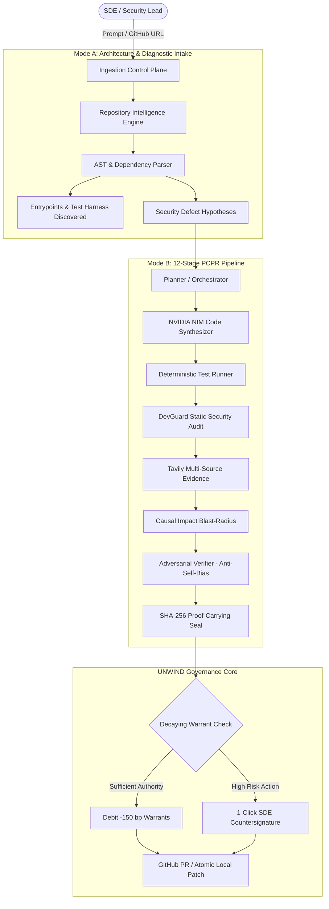

# AEGISNOVA System Architecture Specification

## 1. Architectural Philosophy: Verifiable Trust & Governed Autonomy

AEGISNOVA is engineered as a unified, enterprise-grade AI software engineering, evidence collection, and governed operations platform. Unlike conventional AI code generators that blindly propose code snippets without validation or evaluate their own outputs, AEGISNOVA implements **adversarial verification** and **cryptographic governance**.

Every code modification must survive an exhaustive 12-stage validation loop and receive an authoritative UNWIND governance warrant before entering production.

---

## 2. Multi-Agent System Topology

---

## 3. The 12-Stage Proof-Carrying Pull Request (PCPR) Pipeline

| Stage | Name | Component | Security Invariant |
| :---: | :--- | :--- | :--- |
| **01** | Architecture Discovery | `src/lib/repo-intelligence/analyzer.ts` | Complete AST graph with zero missing entrypoints |
| **02** | Issue Diagnosis | `src/lib/autonomous-engineering/runner.ts` | Strict acceptance criteria scoping |
| **03** | Risk Decomposition | `src/lib/autonomous-engineering/runner.ts` | Atomic rollback snapshot checkpointing |
| **04** | Patch Synthesis | NVIDIA NIM (`Nemotron-4-340B` / `Llama-3.1-405B`) | Context-bounded unified diff generation |
| **05** | Sandbox Test Execution | `unittest` / `npm test` harness | Real process exit code `0` required |
| **06** | DevGuard Security Scan | DevGuard AI Static Scanner | AST inspection for injection, secrets, RCE |
| **07** | Live Evidence Reconciliation | Tavily AI Evidence Client | Live CVE advisories & NIST/MITRE citations |
| **08** | Causal Blast Radius | Causal Impact Engine | Downstream dependency impact mapping |
| **09** | Adversarial Verification | Independent Verification Agent | Evaluates in fresh context (Anti-Self-Verification) |
| **10** | Repair Proof Manifest | Repair Assurance Verifier | SHA-256 root hash of the evidence manifest |
| **11** | UNWIND Governance Gate | UNWIND Authority Ledger | Decaying warrant debit (`-150 bp`) & immutable lineage |
| **12** | GitHub Delivery | GitHub Client Adapter | Cryptographically attested Pull Request or Local Patch |

---

## 4. NightShift 3 AM Patrol: Dual Autonomy Policy

The NightShift Autonomous SDE Engine runs continuous patrol loops over monitored repository fleets. To eliminate on-call alert fatigue while guaranteeing enterprise safety, AEGISNOVA executes the **Dual Autonomy Policy**:

### 4.1 Low / Medium Severity: Zero-Wakeup Self-Healing
- **Scope:** Syntax deprecations, linter violations, static typing drift, dependency patch updates, documentation drift.
- **Workflow:**
  1. Incident detected by AST/test monitoring.
  2. Synthesizes bounded candidate fix.
  3. Executes test sandbox; asserts zero regression.
  4. Records the solution pattern into the **Recurrent Incident Memory Ledger**.
  5. Commits resolution without triggering SDE pagers or waking engineers at 3:00 AM.
  6. **Next Occurrence:** If the exact error signature recurs tomorrow night, the engine performs instant memory-guided auto-healing in 0 ms.

### 4.2 High / Critical Severity: Governed Quarantine
- **Scope:** SQL injection, hardcoded secrets, remote code execution (RCE), authentication bypass, major architectural regressions.
- **Workflow:**
  1. Quarantined immediately in `WAITING_FOR_SDE_APPROVAL`.
  2. Autonomous agents generate root-cause analysis, formulate candidate patch, run Tavily live CVE verification, and execute sandbox tests.
  3. Holds execution until the human on-call engineer delivers a **1-Click Countersignature** via the AEGISNOVA Web UI.
  4. UNWIND warrants are debited (`-150 bp`), and patch is atomically deployed.

---

## 5. Security Invariants & Cryptographic Guarantees

1. **Anti-Self-Verification Invariant:** An agent that writes a patch is never permitted to attest to its safety. Verification must be executed by an isolated adversarial evaluator.
2. **Deterministic Execution Invariant:** No change is marked valid based on LLM assertion alone. A deterministic test runner (`npm test`, `pytest`, `python -m unittest`) must execute in an isolated process and return exit code 0.
3. **Decaying Warrant Invariant:** Action permissions are not static tokens; they are ephemeral decaying warrants that deplete linearly and require periodic human renewal.
